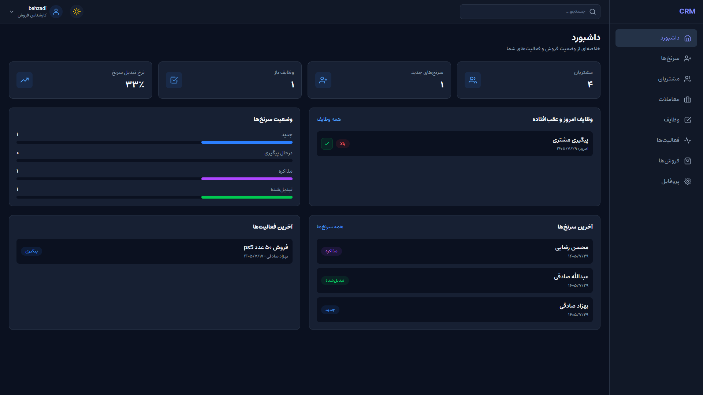
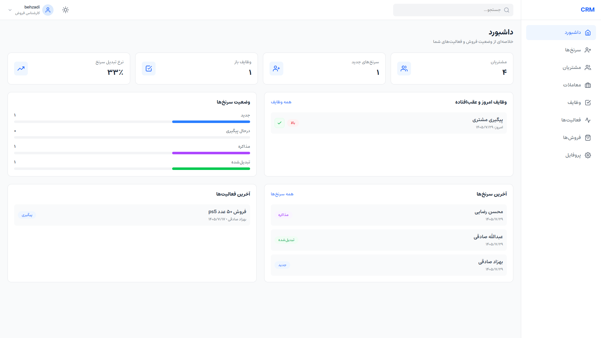
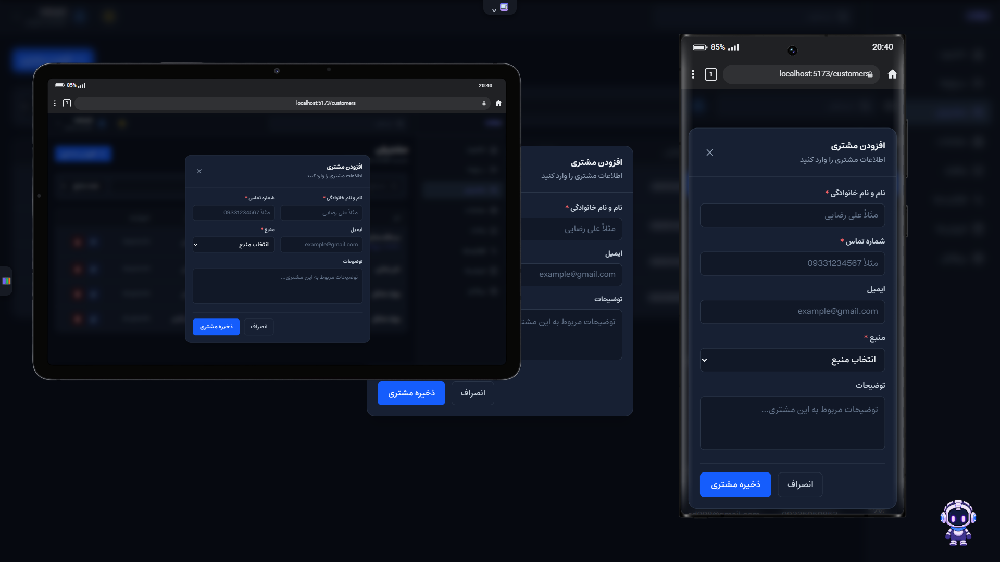
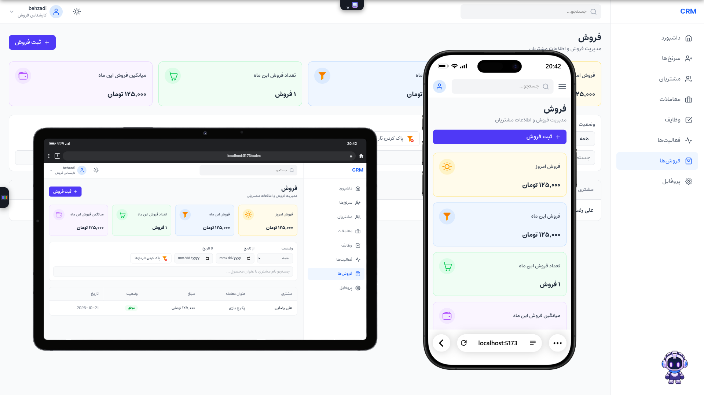

# CRM Dashboard

A modern, responsive **Customer Relationship Management (CRM) dashboard** built with React 19 and Tailwind CSS 4. It covers the full sales workflow: capturing leads, converting them to customers, tracking deals through a pipeline, managing tasks and activities, and recording sales. The UI is fully **RTL (Persian)** with dark mode support.

## Screenshots

### Dashboard



### Customer


### Sales Pipeline


## Features

- **Authentication**: JWT login, protected routes, and automatic logout when a session expires (401 handling)
- **Dashboard**: an overview of leads, customers, tasks, and recent activity
- **Leads**: full CRUD, status tracking (`new`, `following`, `negotiation`, `converted`), detail page, and conversion to customer
- **Customers**: customer management with search and filtering
- **Deals pipeline**: stage-based board (`proposal`, `negotiation`, `won`, `lost`) with deal cards and move between stages
- **Tasks**: task management with priorities (`low`, `medium`, `high`) and due dates
- **Activities**: log calls, messages, emails, meetings, notes, and follow-ups
- **Sales**: record and review completed sales
- **Profile**: user profile and change password
- **Dark / light theme**: persisted across sessions
- **Persian localization**: RTL layout, Jalali date display, Persian digits, Toman currency formatting, and the Estedad variable font
- **Iranian mobile validation**: normalizes `09xxxxxxxxx`, `+989...`, and `00989...` formats (including Persian/Arabic digits) and prevents duplicates across leads and customers

## Tech Stack

| Area | Technology |
| --- | --- |
| UI | React 19 |
| Build tool | Vite 8 |
| Styling | Tailwind CSS 4 |
| Routing | React Router 7 |
| State management | Zustand (with `persist` middleware for theme) |
| Forms & validation | Formik + Yup |
| Notifications | react-hot-toast |
| Icons | react-icons |
| Linting | ESLint 10 |

## Project Structure

```text
src/
├── assets/fonts/        # Estedad variable font
├── Components/          # Shared components (Navbar, Sidebar, ProtectedRoute)
├── Layout/              # App shell (sidebar + navbar + outlet)
├── Pages/               # Feature pages
│   ├── Auth/            # Login / Register
│   ├── Dashboard/
│   ├── Leads/           # List + LeadDetails
│   ├── Customers/
│   ├── Deals/           # Pipeline + DealCard + DealFormModal
│   ├── Tasks/           # List + TaskFormModal
│   ├── Activities/
│   ├── Sales/           # List + SaleFormModal
│   ├── Profile/
│   └── NotFound/
├── Routes/              # Router configuration
├── Store/               # Zustand stores (auth, leads, customers, deals, tasks, activities, theme)
└── Utils/               # fetchData (API wrapper), formatters, phone validation, notifications
```

## Architecture Highlights

- **Centralized API layer**: `fetchData` attaches the JWT, handles JSON parsing, and maps `401` / `403` / network errors to user-friendly messages and automatic logout.
- **Feature-based stores**: each domain (leads, deals, tasks, ...) has its own Zustand store that owns its data fetching and mutations.
- **Route protection**: all application routes are nested under a `ProtectedRoute` guard.
- **Reusable utilities**: shared formatters and validators keep pages thin and consistent.

## Getting Started

### Prerequisites

- Node.js 20+ and npm
- A running backend REST API (see [Backend](#backend))

### Installation

```bash
git clone https://github.com/ibehzadi/crm-dashboard.git
cd crm-dashboard
npm install
```

### Environment variables

Create a `.env` file in the project root:

```env
VITE_BASE_URL=http://localhost:1337/api/
VITE_BASE_FILE=http://localhost:1337/api/upload/
```
* For backend files call with me!

| Variable | Description |
| --- | --- |
| `VITE_BASE_URL` | Base URL of the REST API (must end with `/`) |
| `VITE_BASE_FILE` | Base URL for uploaded files |

### Run

```bash
npm run dev        # start the dev server
npm run build      # production build
npm run preview    # preview the production build
npm run lint       # run ESLint
```

## Backend

The frontend talks to a REST API that follows **Strapi v5 conventions** (`documentId` identifiers, `{ data: ... }` request bodies, `auth/local` login, and `pagination[pageSize]` query parameters). Expected collections:

`leads`, `customers`, `deals`, `tasks`, `activities`, `sales`

## Roadmap

- [ ] Server-side pagination and search (currently fetches up to 100 records per list)
- [ ] Role-based access control
- [ ] Drag-and-drop for the deals pipeline
- [ ] Unit and integration tests
- [ ] CI pipeline (lint + build) with GitHub Actions
- [ ] English / LTR language option

## Author

**Your Name**
[LinkedIn](https://linkedin.com/in/your-profile) · [Email](mailto:you@example.com) · [Portfolio](https://your-site.com)

## License

This project is licensed under the [MIT License](./LICENSE).